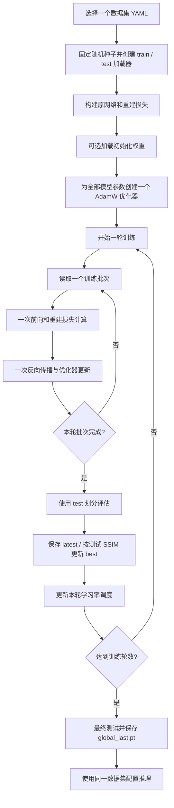

# 网络与训练数据流

## 网络前向

下面对应四份配置中的 `reference_affine` 模式。网络层、参数和计算关系保持原有实现。

```text
illumination, illu_feature = IllumiinationNet(low, ill_list)
light_up = low * illumination + low

image_feature = ImageExtractor(light_up)
event_feature = EventExtractor(event)
holistic_feature = Conv1x1(image_feature || event_feature)

if ReferenceBranch.enabled:
    current_feature = current_encoder(light_up)
    reference_feature = frame_encoder(img_refer)
    statistics = channel_stats(current_feature) || channel_stats(reference_feature)
    gate = sigmoid(Gate(statistics)) * reference_valid
    contrast, shift = tanh(Affine(statistics))
    holistic_feature += residual_scale * gate * (
        contrast * (holistic_feature - channel_mean(holistic_feature))
        + shift * channel_std(holistic_feature)
    )

pred = Unet_ReFormer(
    holistic_feature, light_up, image_feature, snr_map, event_feature
)
```

参考分支在 `ImageEnhanceNet.forward` 中只注入一次。原有 SNR 区域选择、编码器、ReFormer 和解码过程不变。

## 完整训练过程



每轮遍历训练批次属于普通训练流程。原来的辅助数据划分、内外层优化器、临时参数更新与恢复已经移除；训练结束即可使用保存的模型。

## 数据集边界

`get_dataset` 只返回训练和测试两个数据集。`get_split_dataset` 和推理加载器只构建指定目录，不依赖训练目录存在。训练启用原有随机裁剪及成对增强，测试和推理使用确定性的中心裁剪和参考选择。

配置显式区分数据集和输出位置，网络设置不随数据集名称自动切换。需要单独调整训练轮数、学习率、批次大小或参考设置时，编辑对应 YAML 即可。
